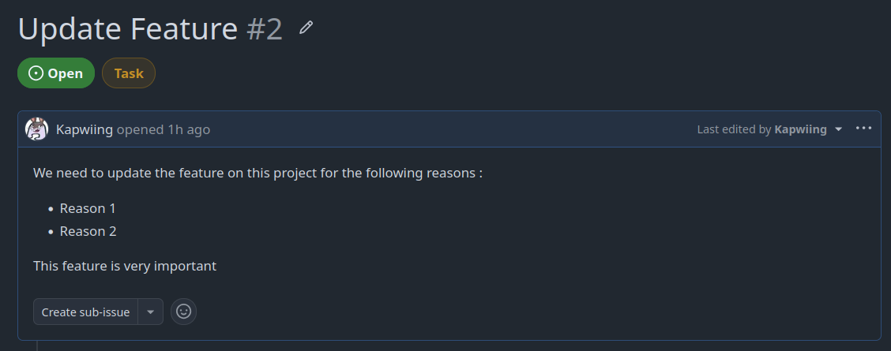
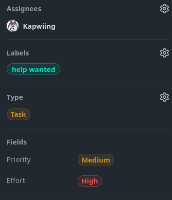
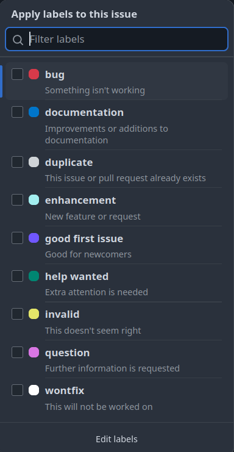
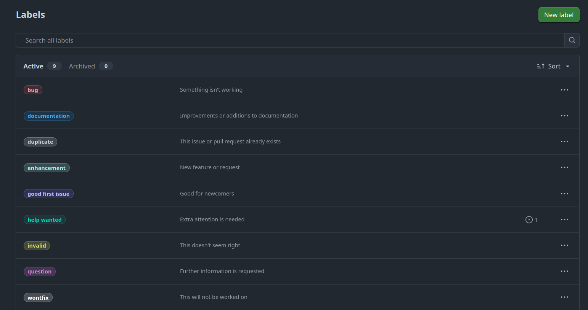
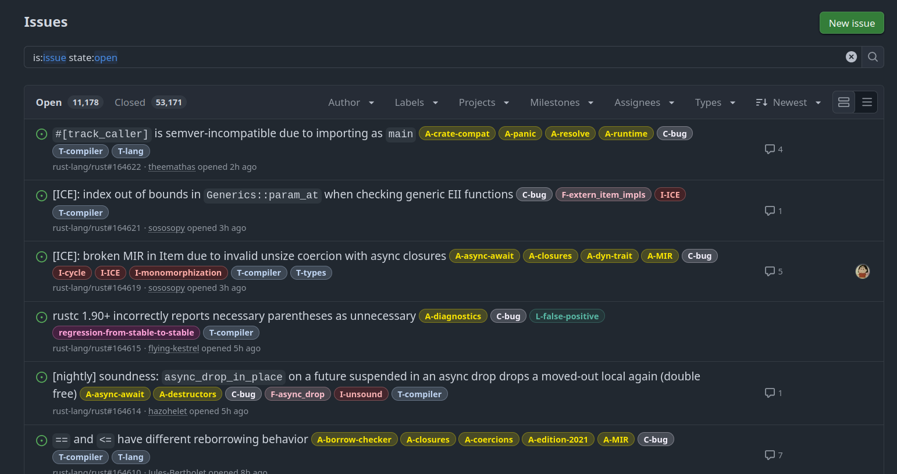
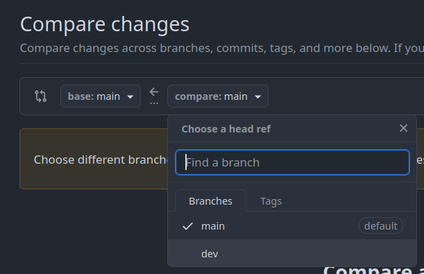
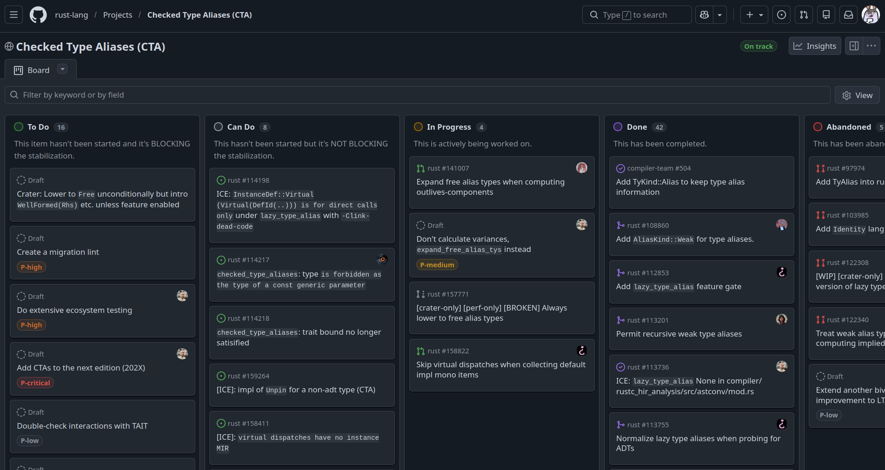
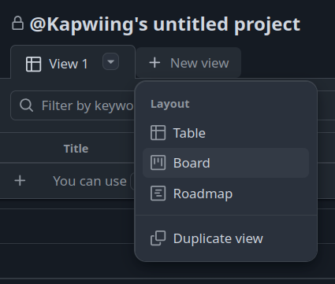

# Workshop – Organiser son travail avec Git et GitHub

L'objectif de ce workshop est de découvrir les outils et les méthodes qui permettent de travailler efficacement sur un projet. Pour les exercices, nous utiliserons votre repository **printf**, mais les principes présentés ici s'appliquent à tous vos projets, que vous travailliez seul ou en équipe.

Au-delà de simplement "faire fonctionner le code", un bon développeur sait également organiser son travail, communiquer avec les autres membres du projet et garder un historique propre de ses modifications.

**Vous devez réaliser ce workshop avec votre binôme de printf**

---

# Les branches Git

Dans un projet, on évite autant que possible de travailler directement sur la branche principale (`main` ou `master`). À la place, on crée des branches dédiées à chaque fonctionnalité, correction de bug ou expérimentation.

Les avantages sont nombreux :

* Pouvoir développer une fonctionnalité sans casser le projet principal,
* Travailler à plusieurs sans modifier les mêmes fichiers en permanence,
* Tester des idées sans risque que la mouli ne puisse pas passer sur votre travail,
* Faciliter les revues de code avant l'intégration.

## Exercice

Créez une branche nommée `dev` sur votre repository puis poussez-la sur GitHub.

> Normalement, le workshop Git vous a déjà appris à faire ça :)

À partir de maintenant, considérez que **`main` est la branche stable**, tandis que **`dev` sert au développement**.

---

# GitHub Issues

*"C'est quoi l'problème ?"*

Une **Issue** est un ticket qui sert à suivre un travail à effectuer sur un projet.

Contrairement à ce que son nom peut laisser penser, une issue ne sert pas uniquement à signaler un bug. Elle peut également représenter :

* Une nouvelle fonctionnalité à développer,
* Une amélioration du code,
* Une tâche technique,
* Une question ou une discussion,
* Un bug à corriger.

L'idée est simple : **une issue = une tâche.**

Cela permet à toute l'équipe de savoir :

* Ce qu'il reste à faire,
* Qui travaille sur quoi,
* Pourquoi une modification est réalisée.

## Bien rédiger une issue

**C'est super important**
Une bonne issue respecte la règle **NDTA** :




### N - Nommer

Choisissez un titre clair et précis.

On évite les : **"Make server"**, **"Fix display"**, **"Feur"**, etc.

On attend plutôt quelque chose dans ce style : **"Le `%x` affiche une valeur incorrecte"**

### D - Décrire

Expliquez le contexte.

* Quel est le problème ?
* Comment le reproduire ?
* Quel est le comportement attendu ?

Plus votre description est précise, moins votre futur vous (ou vos collègues) perdront de temps.

### T - Taguer

Les **labels** permettent de classer les issues.

Par exemple :

* `bug`
* `enhancement`
* `documentation`
* `good first issue`
* `refactor`

Ils facilitent la lecture d'un projet qui contient plusieurs dizaines (ou centaines) d'issues.
Pensez à bien créer des labels quand vous mettez en place votre organisation.

### A - Assigner

Une issue doit avoir un responsable.

Assigner une personne permet de savoir immédiatement qui est chargé de cette tâche.

## Exercice

Depuis l'interface GitHub :

1. Créez une nouvelle issue dans l'onglet **Issues** puis avec le bouton **New issue**
2. Donnez-lui un titre pertinent (en l'occurence en rapport avec votre projet printf)
3. Ajoutez une description
4. Appliquez un label avec l'onglet **Labels** à droite de la page.



Par défaut sur github, des labels sont déjà créés pour vous mais vous pouvez les éditer avec le bouton `Edit Labels` dans les paramètres (bouton engrenage à côté du paneau Label lorsque vous créez votre issue)



5. Assignez-la à vous-même grâce à l'onglet **Assignees** à droite de la page.

Pour info, voilà quoi ressemble la page des issues du **repo du Rust** avec tout plein de tags et de texte :)



---

# Les Pull Requests

*"Reeling them in!"*

Une **Pull Request (PR)** est une demande d'intégration de vos modifications.

Concrètement :

> "J'ai terminé mon travail sur une branche. Est-ce que tout le monde est d'accord pour l'ajouter au projet ?"

Au lieu de fusionner directement une branche, on ouvre une Pull Request afin de :

* Présenter les modifications réalisées ;
* Discuter des choix techniques ;
* Détecter les erreurs ;
* Effectuer une revue de code ;
* Lancer les tests automatiques.

C'est l'outil central du développement collaboratif.

## Pourquoi faire une Pull Request ?

Imaginez que trois personnes travaillent en même temps.

Sans Pull Request : (high cortisol)

* Chacun push directement sur `main` ;
* Des conflits apparaissent rapidement ;
* Une erreur peut casser tout le projet.

Avec une Pull Request : (low cortisol)

* Chacun travaille sur sa branche ;
* Les modifications sont relues avant d'être intégrées ;
* Les conflits sont détectés plus tôt ;
* Le projet reste stable.

Même lorsque vous travaillez seul, les Pull Requests sont utiles : elles vous obligent à prendre du recul et à relire votre propre travail.

Maintenant, *après avoir ajouté des changements sur votre branche `dev`,* vous pouvez créer une pull request dans l'onglet Pull Request.

Sélectionnez bien la branche sur laquelle vous voulez créer votre pull request.



---

# Les Draft Pull Requests

Une Pull Request peut être ouverte en mode **Draft**, ce qui signifie :

> "Mon travail n'est pas terminé, mais je souhaite le partager."

Les autres membres peuvent :

* Suivre votre progression ;
* Donner leur avis ;
* Proposer des améliorations ;
* Anticiper d'éventuels conflits.

Une Draft PR ne peut pas être fusionnée tant qu'elle n'est pas marquée comme **Ready for Review**.

---

# Les Code Reviews

Avant d'intégrer une Pull Request, il est recommandé qu'une autre personne relise le code.

Une review permet notamment de vérifier :

* La lisibilité ;
* Le respect des conventions ;
* La logique de l'algorithme ;
* Les performances ;
* Les cas particuliers oubliés.

*L'objectif n'est pas de critiquer la personne mais d'améliorer le code.*

Un bon développeur passe presque autant de temps à relire du code qu'à en écrire.

---

# Fusionner une Pull Request

*"Pull, Push, Legs"*

Une fois la Pull Request approuvée, GitHub propose plusieurs méthodes de fusion.

## Merge Commit

```
main --------A-----B-----------M
                 \           /
feature ----------C----D-----
```

Git crée un **commit de fusion**.

### Avantages

* Conserve tout l'historique ;
* Montre exactement où la branche a été fusionnée.

### Inconvénients

* L'Historique devient vite difficile à lire.

---

## Squash and Merge

```
feature : C -> D -> E
  ↓
main : A -> B -> F
```

Tous les commits de la branche sont regroupés en **un seul commit**.

### Avantages

* Historique propre ;
* Idéal lorsque la branche contient beaucoup de petits commits du type :

```
fix
oops
encore un fix
ça marche normalement
```

### Inconvénients

* La perte du détail de chaque commit intermédiaire.

Le problème de cette méthode est qu'on perd le détail des commits réalisés, elle est donc à utiliser dans des cas spécifiques où on se retrouve avec une branche avec plein de petit commits.

---

## Rebase and Merge

Avant :
```
main : A --- B
             \
feature       C --- D
```
Après :
```
main : A --- B --- C --- D
```

Git "rejoue" les commits de la branche directement à la suite de `main`.

Le résultat donne l'impression que la branche a toujours fait partie du projet.

### Avantages

* Historique parfaitement linéaire ;
* Très agréable à lire.

### Inconvénients

* Plus complexe à comprendre ;
* Peut devenir dangereux si plusieurs personnes travaillent déjà sur la même branche.

Le rebase est très utilisé dans les projets professionnels, mais demande une bonne compréhension de Git avant d'être utilisé sereinement.

---

# Exercice

* Créer une issue ;
* Créer une branche liée à cette issue ;
* Effectuer une modification sur votre projet `printf` ;
* Ouvrir une Pull Request en mode Draft ;
* Demander une review à un camarade ;
* Corriger les remarques éventuelles ;
* Fusionner la Pull Request avec un **Squash and Merge**.


# GitHub Projects

_"Un tableau pour tout organiser."_

Lorsque le nombre d'issues augmente, il devient difficile de savoir où en est le projet simplement en parcourant la liste des tickets.

Les **GitHub Projects** permettent de visualiser l'avancement du travail grâce à un tableau de bord, similaire à un Kanban (comme Trello ou Jira).

Chaque **issue** devient une carte que l'on peut déplacer au fil de son avancement.

Un workflow classique ressemble à ceci :

```
À faire → En cours → En review → Terminé

```

Ainsi, en un coup d'œil, toute l'équipe peut savoir :

-   Quelles tâches restent à réaliser ;
-   Sur quoi chacun travaille actuellement ;
-   Quelles modifications attendent une review ;
-   Ce qui est déjà terminé.

L'objectif n'est pas seulement d'organiser le projet, mais aussi d'améliorer la communication entre les membres de l'équipe.

Sur un gros projet comme **le repo du Rust**, voilà à quoi ressemble un github projet bien organisé :



Commencez par créer un Github project dans l'onglet **Projects** en haut.
Rajoutez également une nouvelle vue `Board`. Cette vue va nous permettre d'organiser les tâches dans le style **Kanban**



----------

# Lier les Issues au Project

Créer un Project ne suffit pas : il faut y ajouter les issues.

**Depuis une issue, il est possible de l'associer à un Project afin qu'elle apparaisse automatiquement dans le tableau.**

Séléctionnez une issue que vous avez déjà créée et dans l'onglet `Project` à droite, associez-la au projet que vous avez créé. Assurez-vous que l'issue créee est associée à un **statut** (Todo, In Progress, etc)

Une fois liée, il devient très simple de suivre son évolution en déplaçant la carte entre les différentes colonnes.

Par exemple :

```
Nouvelle issue
        ↓
     À faire
        ↓
Création d'une branche
        ↓
	 En cours
        ↓
Ouverture d'une Pull Request
        ↓
    En review
        ↓
Merge de la Pull Request
        ↓
      Terminé
```

Sur de nombreux projets, ces déplacements sont réalisés automatiquement grâce aux automatisations de GitHub. Par exemple :

-   lorsqu'une Pull Request est ouverte, l'issue passe en **En review** ;
-   lorsque la Pull Request est fusionnée, l'issue passe en **Terminé**.

---

# Associer une Pull Request à une Issue

Une Pull Request peut être directement liée à une issue.

Pour cela, il suffit de mentionner son numéro dans la description de la Pull Request avec un mot-clé comme :

```
Closes #12
```
ou
```
Fixes #12
```

Lorsque la Pull Request est fusionnée :
-   l'issue est automatiquement fermée ;
-   GitHub crée un lien entre l'issue et la Pull Request ;
-   il devient très facile de retrouver pourquoi une modification a été réalisée.

On obtient alors un workflow complet :

```
Issue
   ↓
Branche
   ↓
Commits
   ↓
Pull Request
   ↓
Review
   ↓
Merge
   ↓
Issue fermée
```

C'est cette organisation qui est utilisée sur la majorité des projets professionnels.

---

# Exercice

1.  Créez un nouveau **GitHub Project**.

2.  Ajoutez les colonnes :
    -   À faire
    -   En cours
    -   En review
    -   Terminé

3.  Ajoutez votre issue au Project.

4.  Déplacez-la dans **En cours**.

5.  Lors de la création de votre Pull Request, liez-la à votre issue en utilisant `Closes #<numéro>`.

6.  Vérifiez qu'après la fusion de la Pull Request, l'issue est automatiquement fermée.

---


# GitHub Actions

Jusqu'ici, toutes les vérifications (compiler le projet, lancer les tests, vérifier le style du code...) sont faites **à la main**. Et ce qui est fait à la main finit toujours par être oublié.

**GitHub Actions** est l'outil d'**intégration continue** (CI/CD) intégré à GitHub. Il permet d'exécuter automatiquement des tâches lorsqu'un événement se produit sur le dépôt, par exemple :
-   un `push` sur une branche ;
-   l'ouverture ou la mise à jour d'une Pull Request ;
-   la création d'une issue ;
-   une exécution planifiée (tous les jours à minuit, par exemple).

Ces automatisations sont décrites dans des fichiers **YAML** placés dans le dossier `.github/workflows/` du dépôt :

```yaml
name: CI

on:
  pull_request:
    branches: [main]

jobs:
  build:
    runs-on: ubuntu-latest
    steps:
      - uses: actions/checkout@v4
      - name: Compiler le projet
        run: make
      - name: Lancer les tests
        run: make tests_run
```

Quelques notions à retenir :
-   **Workflow** : un fichier YAML décrivant une automatisation ;
-   **Event** (`on`) : l'événement qui déclenche le workflow ;
-   **Job** : un ensemble d'étapes exécutées sur une même machine (*runner*) ;
-   **Step** : une commande (`run`) ou une action réutilisable (`uses`).

Combinées aux Pull Requests, les GitHub Actions permettent par exemple d'**empêcher la fusion** d'une PR tant que le projet ne compile pas ou que les tests échouent. La review humaine peut alors se concentrer sur la logique du code plutôt que sur les erreurs évidentes.

## Pour aller plus loin

Pour découvrir les GitHub Actions de manière interactive, suivez les leçons de **GitHub Actions Hero** :

👉 [https://github-actions-hero.vercel.app/lessons/1](https://github-actions-hero.vercel.app/lessons/1)

---
